=== FivePrayer ===
Contributors: Jamaaldev,AhsanulBarakah
Tags: prayer, Muslim, salat, quran, islamic
Donate link: https://www.buymeacoffee.com/jamaaldev
Requires at least: 6.7
Tested up to: 7.2
Stable tag: 3.0.0
Requires PHP: 7.4
License: GPLv3 or later
License URI: https://www.gnu.org/licenses/gpl-3.0.txt

Five Prayer displays accurate Muslim prayer times and full-year timetables inside WordPress.

== Description ==
**Five Prayer** shows prayer times and a full-year timetable on any WordPress site, with any theme and any page builder.

Version **3.0.0** is compatible with **WordPress 7.2**.

**Download:** [latest release](https://github.com/AhsanulBarakah/fiveprayer/releases/latest) — install `fiveprayer-x.y.z.zip` from the Releases page.

**Try it without installing:** [open the live preview](https://playground.wordpress.net/?blueprint-url=https://raw.githubusercontent.com/AhsanulBarakah/fiveprayer/main/playground/blueprint.json) — WordPress Playground boots in your browser with FivePrayer already activated.

Ideal for mosques, Islamic centers, community masjids and prayer halls.

See **changelog.txt** for what each feature does.

== Live Preview ==
Click **[open FivePrayer in WordPress Playground](https://playground.wordpress.net/?blueprint-url=https://raw.githubusercontent.com/AhsanulBarakah/fiveprayer/main/playground/blueprint.json)** to run the plugin in a sandbox WordPress inside your browser — nothing to install and nothing to clean up. The blueprint in `playground/blueprint.json` installs the release zip, activates FivePrayer and opens it in the admin sidebar.

The preview downloads the asset straight from the Releases page, so it always runs the version published there.

== Features ==
* Full-year prayer timetable
* Monthly timetable printing
* Timetable styles, print header text and logo
* Custom location
* Hijri Calendar
* Ramadan start adjustment
* Custom Translation
* Iqama delay
* Tune offsets
* Table Display Options
* Timetable Layout customizer
* Feature Switches
* Configure Settings
* Custom prayer calculation methods (MWL, ISNA, Umm Al-Qura and your own)
* Unified Method (custom criteria and seasonal switching)
* London Unified Prayer Times — paste the full printed year (all 12 months) into Unified Method, or apply the built-in London Unified / East London printed safety margins
* Rounding method (nearest / up / down / none)
* Day-to-Day Smoothing
* Calendar Type (Gregorian, Hijri or Persian year)
* Asr calculation by school (1 Mithl or 2 Mithl)
* Second Asr (2 Mithl) column, shortcode and builder field
* Advanced Schedules (beta)
* Next Prayer Countdown
* Extra Prayers
* Day Display
* Next-prayer highlight
* TV Display Mode (beta)
* Share on Local Network
* Display Settings
* Public REST API
* API Management
* API Security
* Import, export and reset settings
* Optional anonymous usage telemetry (opt-in)
* Page builder support
* Gutenberg blocks
* Caching plugin compatibility

== Shortcodes ==
* `[Fp_TimeTable_Monthly]`
* `[Fp_Vertical_Daily_Prayer]`
* `[Fp_Single_Next_Prayer_Remaining]`
* `[Fp_Extra_Prayer_1]` … `[Fp_Extra_Prayer_6]`
* `[Fp_Printer_Button]`
* `[Fp_Printer_Button_URL]`
* `[Fp_Single_CurrentDate]`
* `[Fp_Single_Hijra_Date]`
* `[Fp_Single_CurrentTime]`
* Per-prayer `_Name`, `_Begins_time` and `_Iqamah_time`
* `[Fp_Single_Asr_2_Begins_time]` — the second Asr (2 Mithl / Hanafi)

The complete shortcode list is in **Docs**; see **changelog.txt** for what each one does.

== Deprecated ==
16 deprecated shortcodes still render:

* `[Fp_Single_Fajr_Begins]`, `[Fp_Single_Dhuhr_Begins]`, `[Fp_Single_Asr_Begins]`, `[Fp_Single_Maghrib_Begins]`, `[Fp_Single_Isha_Begins]`
* `[Fp_Single_Fajr_Iqamah]`, `[Fp_Single_Dhuhr_Iqamah]`, `[Fp_Single_Asr_Iqamah]`, `[Fp_Single_Maghrib_Iqamah]`, `[Fp_Single_Isha_Iqamah]`
* `[Fp_Single_Midnight_Begins]`, `[Fp_Single_Sunrise_Begins]`
* `[Fp_Single_NextPrayerIqamahTime]`, `[Fp_Single_NextPrayerIqamahTitle]`, `[Fp_Single_NextPrayerBeginsTime]`, `[Fp_Single_NextPrayerBeginsTitle]`

Replacements are listed in **changelog.txt**.

== Installation ==
= Automatic Installation =
1. Go to **Plugins > Add New**.
2. Search for **Five Prayer**.
3. Click **Install Now**, then activate.

= Manual Installation =
1. Upload the **Five Prayer** folder to `/wp-content/plugins/`.
2. Activate **Five Prayer** from the **Plugins** menu.

== After Activation ==
These five steps turn a fresh install into a working timetable. The screenshots are FivePrayer 3.0.0 on WordPress 7.1.

= 1. Set the timezone =
**Settings > General > Timezone**, choose your city and click **Save Changes**. Prayer times are local clock times, so this has to be right before anything is generated.

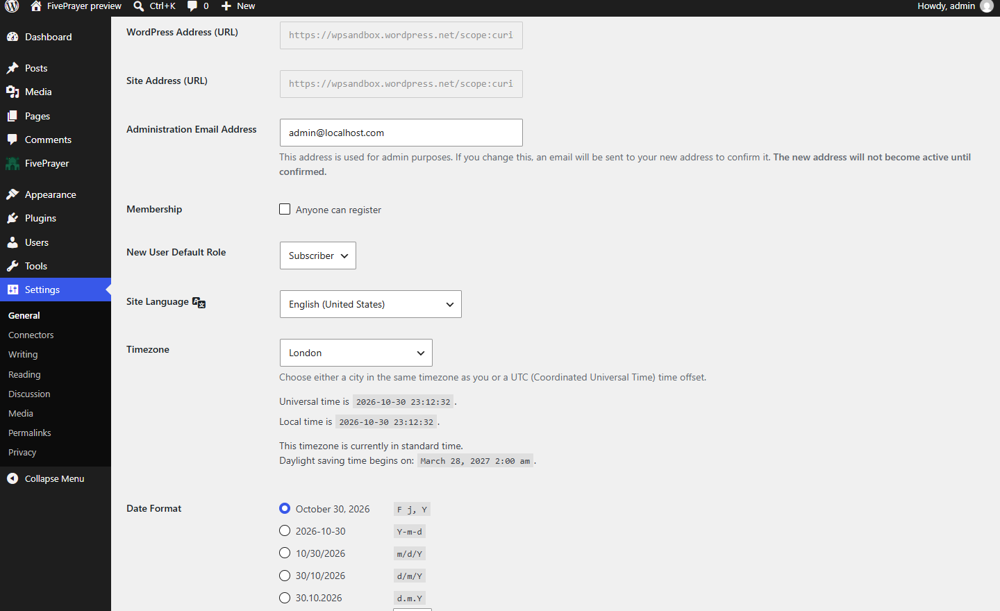

= 2. Add your location =
**FivePrayer > Customizing > Location**. Fill in Country, City, Latitude and Longitude, then click **Add Location**. Saved locations are what the "Location, City" field on the next screen lists.

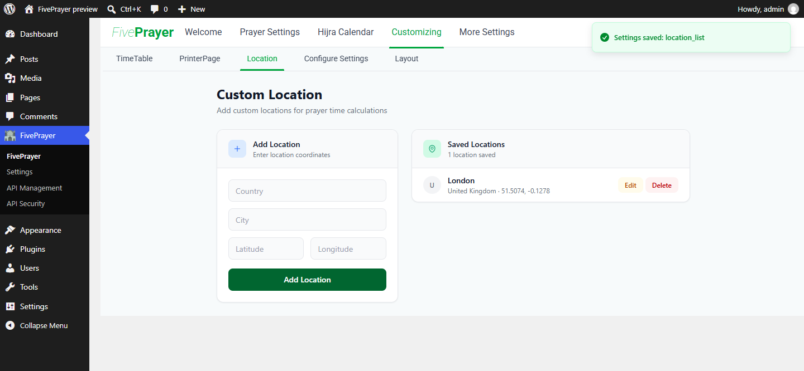

= 3. Fill in Prayer Settings =
**FivePrayer > Prayer Settings**. Choose the **Month** you want to print, the saved **Location, City**, then **Higher Latitude Adjustment**, **Calculation Method**, **Asr Calculation** and **Midnight Calculation Mode**. The minute fields (Tune Prayer, Iqamah Delay) are optional; leave them at 0 if you want the calculated times.

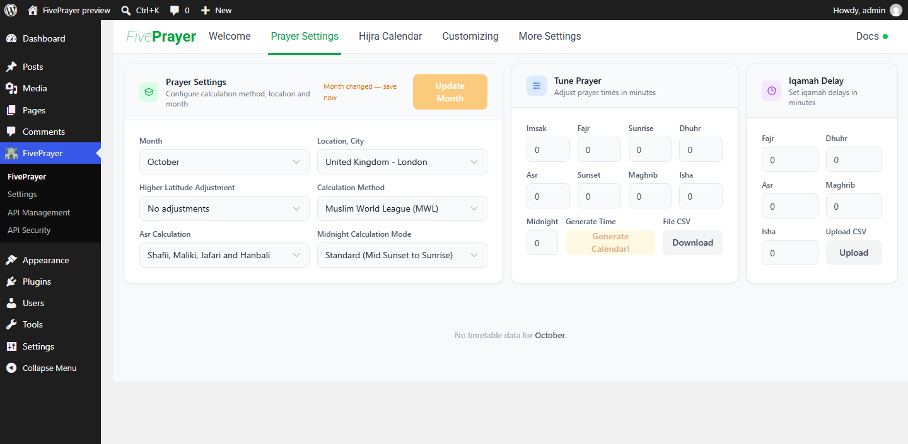

= 4. Generate the calendar =
Click **Generate Calendar** in the Tune Prayer card. It saves every setting above and builds the timetable for the whole year, so the table appears underneath in the same screen.

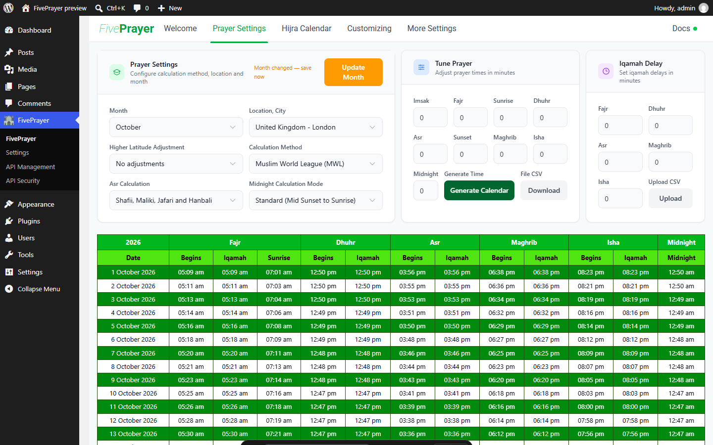

= 5. Check the timetable =
**Customizing > TimeTable** shows the generated month. Colours, headers and rows are changed there and stored with **Save Colors**.

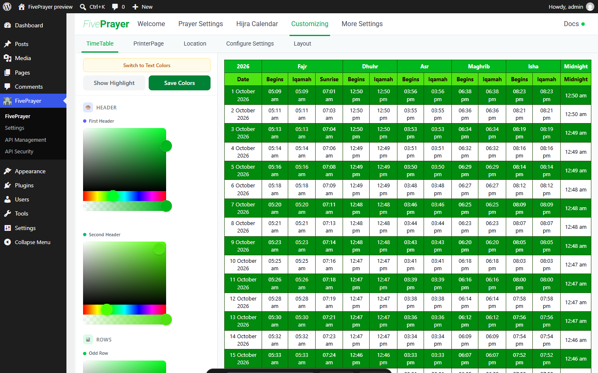

== Upgrade Notice ==
= 3.0.0 =
Compatible with WordPress 7.2. Back up before upgrading from 2.4.x; **changelog.txt** lists every new and changed feature.

== Frequently Asked Questions ==
= Does it work with caching plugins? =
Yes.

= How do I clear the cache? =
Click **Generate Calendar** in Prayer Settings.

= What is TV Display Mode? =
An opt-in full-screen display for a mosque TV. See **changelog.txt**.

= Does Five Prayer have an API? =
Yes. See **changelog.txt**.

= Does it collect any data? =
Only with explicit administrator opt-in.

== Screenshots ==
Version 3.0.0 running on WordPress 7.1, captured from the live Playground preview.

| | |
| --- | --- |
| **Welcome** — quick start, upgrade notice, docs | **Prayer Settings** — method, location, month, tuning |
| 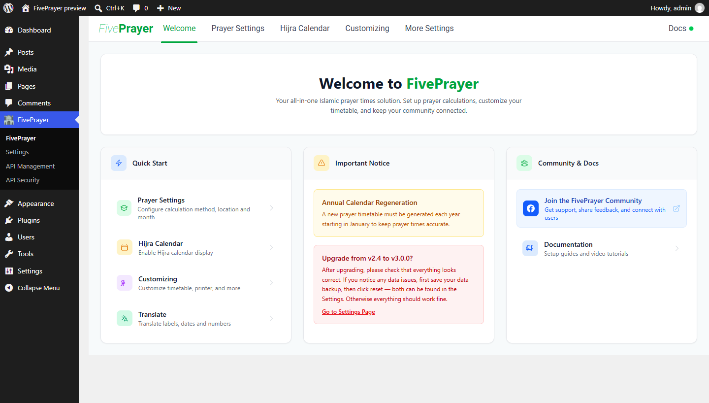 | 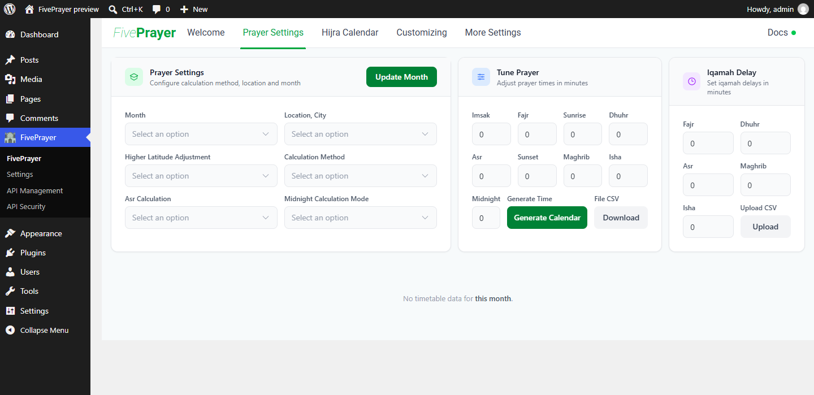 |
| **Customizing > Location** — search or enter coordinates | **Customizing > TimeTable** — colours, headers and rows |
| 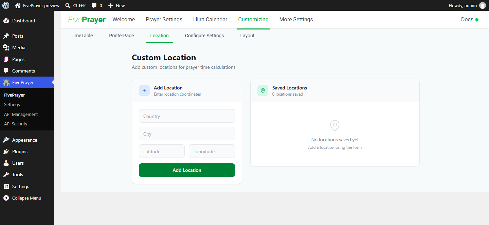 | 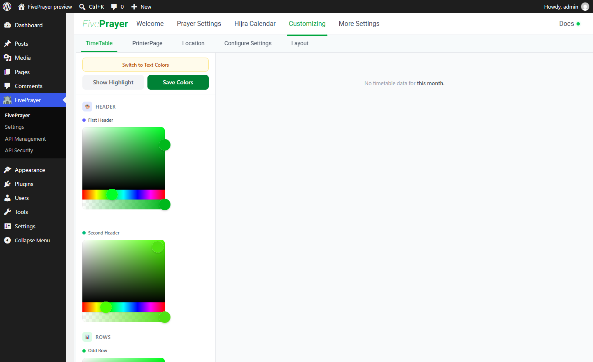 |
| **Customizing > Configure Settings > Feature Switches** — turn each feature on or off | **More Settings > Translate > Prayer Names** — rename every label |
| 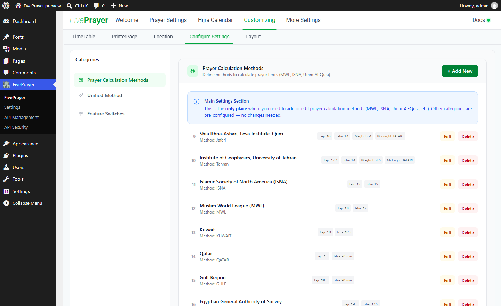 | 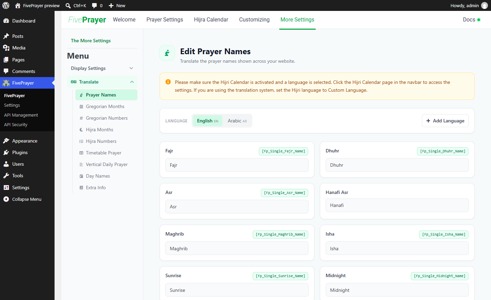 |

Set your timezone under **Settings > General** before generating the timetable.

== Changelog ==
= 3.0.0 =
Compatible with WordPress 7.2. See **changelog.txt** for the complete version history, or read it online at https://fiveprayer.com/changelog.

== Contributors ==
* [@jamaaldev](https://github.com/jamaaldev) — owner and original author
* [@AhsanulBarakah](https://github.com/AhsanulBarakah) — contributor and maintainer

== Development ==
Requirements: Node 22+, pnpm, PHP 8.3+ and Composer.

1. `pnpm install` — installs dependencies and enables the pre-commit hook from `.githooks/pre-commit`.
2. `npm run hooks:install` — re-enables that hook by hand in a fresh clone.
3. `npm run build` — production build; `npm test` — unit, JS and PHP suites.

Commit messages carry no AI attribution — see `AGENTS.md` for that and the other repository conventions.

The hook lints staged PHP, typechecks, and runs the unit and TV-display suites before every commit. Skip it deliberately with `SKIP_CHECKS=1 git commit` or `git commit --no-verify`. GitHub runs the same checks, plus the production build and the WordPress-backed PHP tests, on every push and pull request — see `.github/workflows/checks.yml` and the badges above. The Security workflow adds three more: a dependency audit (`pnpm audit`), the PHP security scan (`npm run lint:php-security`, which fails on `eval()`, shell execution, `unserialize()`, variable includes and SQL built from request data) and the WordPress hardening suite.
