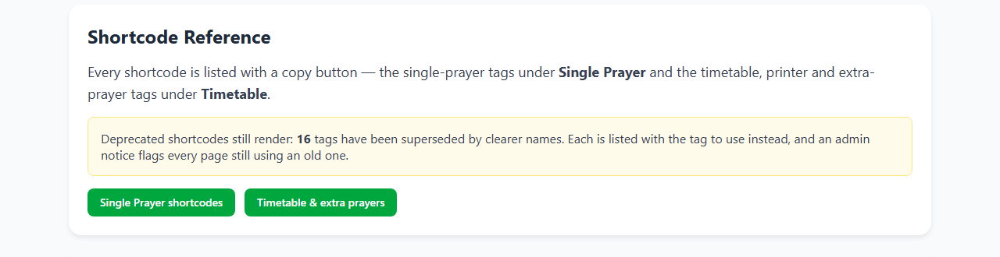
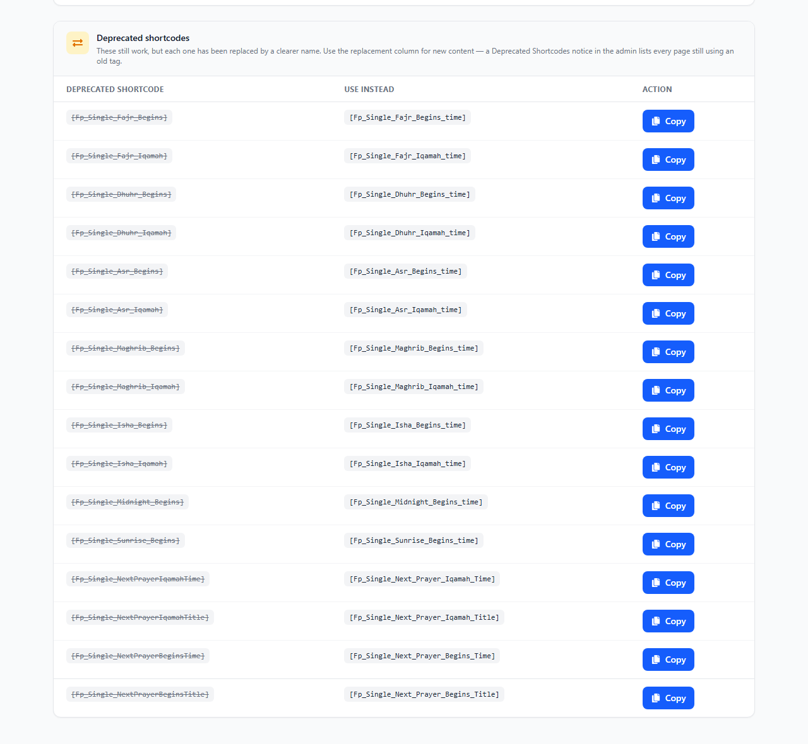

# FivePrayer Shortcode Reference

Every shortcode the plugin registers, matching the list in the admin **Documentation** section (FivePrayer → Documentation → Single Prayer and → Timetable). Paste any of them into a page, post or widget.

Tags are registered from `php/classes/core/ShortCodes/Data/ShortCodeMap.php`; the timetable, printer-button and extra-prayer tags are registered by their own handlers.

## Timetable and printer buttons

| Shortcode | What it does |
| --- | --- |
| `[Fp_TimeTable_Monthly]` | The monthly prayer timetable. The printer button sits outside the table (the default). |
| `[Fp_TimeTable_Monthly printer_option="outside"]` | Same as the default. |
| `[Fp_TimeTable_Monthly printer_option="inside"]` | Places the printer button inside the table. |
| `[Fp_Printer_Button]` | Prints the timetable on the current page; the visitor is not taken anywhere else. |
| `[Fp_Printer_Button_URL]` | Redirects to the custom URL set in Display Settings, with the selected month passed dynamically. Renders nothing until a URL is saved. |

## Vertical daily prayer and countdown

| Shortcode | What it does |
| --- | --- |
| `[Fp_Vertical_Daily_Prayer]` | Today's prayers in a vertical block: current time and date, the next-prayer notice and, when enabled, the live countdown. |
| `[Fp_Single_Next_Prayer_Remaining]` | The live time remaining until the next prayer. Already included in the vertical block; enable it under Configure Settings → Next Prayer Countdown. |

## Prayer times

| Shortcode | What it does |
| --- | --- |
| `[Fp_Single_Fajr_Begins_time]` | Fajr begins time (e.g. "05:10 AM"). |
| `[Fp_Single_Fajr_Iqamah_time]` | Fajr iqamah time (e.g. "05:17 AM"). |
| `[Fp_Single_Dhuhr_Begins_time]` | Dhuhr begins time. |
| `[Fp_Single_Dhuhr_Iqamah_time]` | Dhuhr iqamah time. |
| `[Fp_Single_Asr_Begins_time]` | Asr begins time. |
| `[Fp_Single_Asr_2_Begins_time]` | Second ‘Asr (2 Mithl / Hanafi) begins time — blank when the day has none stored. |
| `[Fp_Single_Asr_Iqamah_time]` | Asr iqamah time. |
| `[Fp_Single_Maghrib_Begins_time]` | Maghrib begins time. |
| `[Fp_Single_Maghrib_Iqamah_time]` | Maghrib iqamah time. |
| `[Fp_Single_Isha_Begins_time]` | Isha begins time. |
| `[Fp_Single_Isha_Iqamah_time]` | Isha iqamah time. |
| `[Fp_Single_Midnight_Begins_time]` | Midnight (Qiyām Al-Layl) time. |
| `[Fp_Single_Sunrise_Begins_time]` | Sunrise time. |

## Prayer names and titles

| Shortcode | What it does |
| --- | --- |
| `[Fp_Single_Fajr_Name]` | The name "Fajr". |
| `[Fp_Single_Dhuhr_Name]` | The name "Dhuhr". |
| `[Fp_Single_Asr_Name]` | The name "Asr". |
| `[Fp_Single_Maghrib_Name]` | The name "Maghrib". |
| `[Fp_Single_Isha_Name]` | The name "Isha". |
| `[Fp_Single_Sunrise_Name]` | The name "Sunrise". |
| `[Fp_Single_Midnight_Name]` | The name "Midnight" (Qiyām Al-Layl). |
| `[Fp_Single_Prayer_Begins_Title]` | The begins column title (e.g. "Begins"). |
| `[Fp_Single_Prayer_Iqamah_Title]` | The iqamah column title (e.g. "Iqamah"). |
| `[Fp_Single_Prayer_Title]` | The static word "Prayer", used in the vertical block header. |
| `[Fp_Single_PTFT]` | The "Prayer Times For Today" style heading from the Translate settings. |

## Dates, times and place

| Shortcode | What it does |
| --- | --- |
| `[Fp_Single_CurrentDate]` | The current Gregorian date; carries the Day Display parts (weekday and/or day number) when that feature is on. |
| `[Fp_Single_Hijra_Date]` | The current Hijri date (e.g. "15 Ramadan 1447"). |
| `[Fp_Single_CurrentTime]` | The current time, updating live. |
| `[Fp_Single_Current_Title]` | The current-prayer title from the Translate settings. |
| `[Fp_Single_Current_Location]` | The location text from the Translate settings. |
| `[Fp_Single_Masjid_Name]` | The masjid name from the Translate settings. |

## Next prayer

| Shortcode | What it does |
| --- | --- |
| `[Fp_Single_Next_Prayer_Begins_Time]` | Begins time of the next prayer; updates as the day moves on. |
| `[Fp_Single_Next_Prayer_Iqamah_Time]` | Iqamah time of the next prayer. |
| `[Fp_Single_Next_Prayer_Begins_Title]` | Next prayer title (e.g. "Fajr Begins"). Accepts `removeNextWord="true"` / `removeSpecificWord="…"` (and the snake_case forms) to drop words. |
| `[Fp_Single_Next_Prayer_Iqamah_Title]` | Next prayer iqamah title (e.g. "Fajr Iqamah"). |
| `[Fp_Single_Next_Prayer_Title]` | The static text "Next Prayer". |
| `[Fp_Single_Next_Prayer_Remaining]` | The live countdown, described above. |

## Extra prayers

| Shortcode | What it does |
| --- | --- |
| `[Fp_Extra_Prayer_1]`, `[Fp_Extra_Prayer_2]`, `[Fp_Extra_Prayer_3]`, `[Fp_Extra_Prayer_4]`, `[Fp_Extra_Prayer_5]`, `[Fp_Extra_Prayer_6]` | The six optional extra-prayer slots (Jumu'ah, Eid, Taraweeh, …) configured under Configure Settings → Extra Prayers. Each accepts `name="…"`, `time="…"` or `note="…"` to override the saved slot for that placement. |

## Page builders

Elementor, Breakdance and Oxygen expose the same fields as native controls, so a builder element needs no shortcode. The second ‘Asr is the field **Hanafi Begins Time (2 Mithl)** — in Elementor it is the dynamic tag `FivePrayer - Hanafi Begins Time (2 Mithl)` (the tag's own name is still `fiveprayer_asr_2_begins_time`, so elements saved under the old label keep working). It reads the stored `asr_second_begins` value, so it prints the 2 Mithl time generated alongside a 1 Mithl ‘Asr and stays blank on a day that has none.

## Deprecated shortcodes

Still registered and still render, but each one has a clearer replacement. Use the right-hand column for new content — an admin **Deprecated Shortcodes** notice lists every page that still uses an old tag.

| Deprecated | Use instead |
| --- | --- |
| `[Fp_Single_Fajr_Begins]` | `[Fp_Single_Fajr_Begins_time]` |
| `[Fp_Single_Fajr_Iqamah]` | `[Fp_Single_Fajr_Iqamah_time]` |
| `[Fp_Single_Dhuhr_Begins]` | `[Fp_Single_Dhuhr_Begins_time]` |
| `[Fp_Single_Dhuhr_Iqamah]` | `[Fp_Single_Dhuhr_Iqamah_time]` |
| `[Fp_Single_Asr_Begins]` | `[Fp_Single_Asr_Begins_time]` |
| `[Fp_Single_Asr_Iqamah]` | `[Fp_Single_Asr_Iqamah_time]` |
| `[Fp_Single_Maghrib_Begins]` | `[Fp_Single_Maghrib_Begins_time]` |
| `[Fp_Single_Maghrib_Iqamah]` | `[Fp_Single_Maghrib_Iqamah_time]` |
| `[Fp_Single_Isha_Begins]` | `[Fp_Single_Isha_Begins_time]` |
| `[Fp_Single_Isha_Iqamah]` | `[Fp_Single_Isha_Iqamah_time]` |
| `[Fp_Single_Midnight_Begins]` | `[Fp_Single_Midnight_Begins_time]` |
| `[Fp_Single_Sunrise_Begins]` | `[Fp_Single_Sunrise_Begins_time]` |
| `[Fp_Single_NextPrayerIqamahTime]` | `[Fp_Single_Next_Prayer_Iqamah_Time]` |
| `[Fp_Single_NextPrayerIqamahTitle]` | `[Fp_Single_Next_Prayer_Iqamah_Title]` |
| `[Fp_Single_NextPrayerBeginsTime]` | `[Fp_Single_Next_Prayer_Begins_Time]` |
| `[Fp_Single_NextPrayerBeginsTitle]` | `[Fp_Single_Next_Prayer_Begins_Title]` |

Both screenshots are generated from the components themselves: run `npm run docs:screenshots` after changing either Docs page (it needs a `npm run build` first, and Chrome — override the browser with `CHROME_PATH`).

`[Fp_Single_CurrentDate]` and `[Fp_Single_CurrentTime]` appear in the deprecated list on the PHP side only so older installs keep working — they are current shortcodes and need no replacement.
